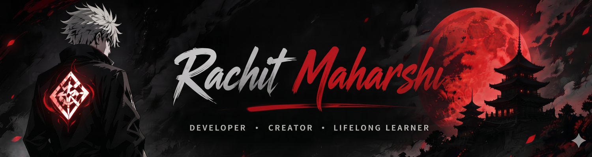

  

# RACHIT MAHARSHI

### DEVELOPER • CREATOR • LIFELONG LEARNER

*Curious mind. Lifelong learner. Building things one project at a time.* ⚡

---

<table>
<tr>
<td width="32%" valign="top" align="center">

# Rachit Maharshi

**rachit1845-roko**

Curious mind. Lifelong learner.  
Building things one project at a time. ⚡

📍 Bharatpur, Rajasthan, India

 

</td>

<td width="68%" valign="top">

## 🔴 ABOUT ME

I'm Rachit, an aspiring developer, creator and anime enthusiast.

I love exploring technology, building interesting projects, experimenting with ideas and diving into stories — whether in code, anime or novels.

| 💻 | 🎬 | 📖 | ⭐ |
|---|---|---|---|
| Code & Build | Create & Share | Read & Write | Keep Growing |

---

## 🚀 CURRENTLY EXPLORING

---

## 🎯 WHAT I'M AIMING FOR

- Building practical projects.
- Improving my programming skills.
- Exploring modern technologies.
- Creating useful applications.
- Growing as a developer.

</td>
</tr>
</table>

---

## 📊 GITHUB STATISTICS

 

---

## 📌 FEATURED PROJECTS

*Every great project starts with an idea.*

**More projects coming soon. Stay tuned!**

---

## 🌌 BEYOND TECHNOLOGY

| Interest | What I Enjoy |
|---|---|
| 🎬 Anime & Manga | Stories, characters and worldbuilding |
| 📚 Reading & Writing | Books, novels and storytelling |
| ⚽ Football | The beautiful game |
| 🎨 Creative Design | Visuals and digital creativity |
| 🤖 Artificial Intelligence | Exploring emerging technology |

---

## 🤝 CONNECT WITH ME

  

### "Dream it. Build it. Improve it."

*Learning in public. Building with purpose.* ⚡

